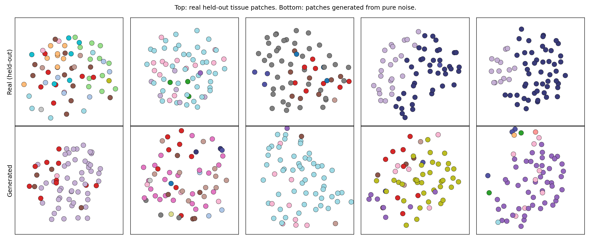
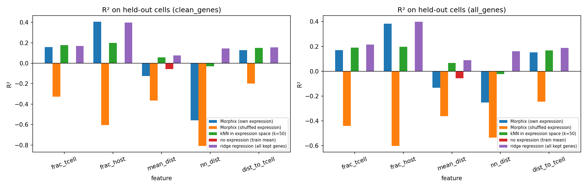
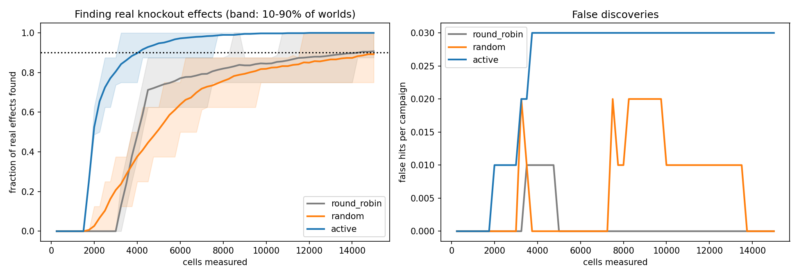
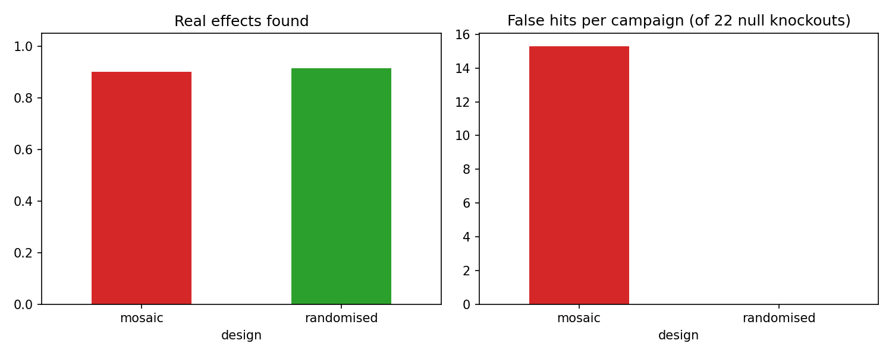

<div align="center">

# BlackPearl Morphix

**Generative models of tissue neighbourhoods from spatial single-cell data,<br>and what they can and cannot learn about genetic perturbations**

Aditya Raj<sup>1</sup> · Senthuran Srimurugan<sup>1</sup> · Utkarsh Raj<sup>2</sup> · Sughra Azim<sup>3</sup>

<sup>1</sup> School of Informatics, The University of Edinburgh &nbsp;·&nbsp; <sup>2</sup> SRM Institute of Science and Technology, Chennai (visiting student, The University of Edinburgh) &nbsp;·&nbsp; <sup>3</sup> School of Physics and Astronomy, The University of Edinburgh

With guidance from **Shubham Kumar** (KU Leuven) and **Prachi Prakash** (Yale University)

[](paper/main.tex)
[](LICENSE)
[](requirements.txt)
[](#reproducing-the-results)

</div>

> **Status:** research draft (October 2026). A hypothesis-generation tool only; not for clinical or diagnostic use.

---

## Team

| | Affiliation | Role |
|---|---|---|
| **Aditya Raj** | School of Informatics, University of Edinburgh | Project lead: research vision; Stages 1–3; paper and figures |
| **Senthuran Srimurugan** | School of Informatics, University of Edinburgh | Stage 3: virtual laboratory and experiment design |
| **Utkarsh Raj** | SRM Institute of Science and Technology, Chennai; visiting student, University of Edinburgh | Stages 1–3: machine-learning methods and analysis |
| **Sughra Azim** | School of Physics and Astronomy, University of Edinburgh | Stages 1–3: computational and quantitative analysis; paper and figures |
| **Shubham Kumar** | Faculty of Bioscience Engineering, KU Leuven (PhD researcher, MELiSSA POMP4) | Scientific guidance: biological framing, omics data and bioinformatics |
| **Prachi Prakash** | Yale University | Brainstorming and research direction |

## Overview

How cells are arranged in a tissue is as informative as what each cell is doing. **Morphix** represents a small piece of tissue as an *unordered set of cells* (2D positions and cell types) and learns to generate realistic neighbourhoods with **conditional flow matching** and a **permutation-equivariant, distance-aware transformer**.

We use it to ask three questions of public spatial data:

1. **Can a generative model learn tissue organisation?** Yes.
2. **Can it predict how a CRISPR knockout changes a cell's neighbourhood from an existing pooled screen?** No, and we show why.
3. **Does a cell's own gene expression predict its neighbourhood?** Yes, after guarding against signal leaking from neighbouring cells.

A simulated laboratory built on real tumour tissue then shows that **randomised layouts combined with active experiment selection** find knockout effects with several-fold fewer cells. This motivates a closed-loop, robot-executed laboratory.

## Key results

| Stage | Question | Outcome |
|:---:|---|---|
| **1** | Can it learn tissue organisation? <br><sub>mouse embryo seqFISH, 19,416 cells</sub> | ✅ Closes **87 ± 8%** of the random-to-real gap in cell-type neighbourhood structure on held-out tissue (3 splits), and beats a composition-matched shuffled baseline in every split. An explicit physics (overlap) prior gave no benefit. |
| **2** | Can it predict knockout-specific neighbourhoods? <br><sub>Perturb-FISH tumour screen, 187,215 cells, 35 knockouts</sub> | ❌ A location-controlled test finds real effects (14 significant tests across 7 knockouts; e.g. NFKBIA cells sit further from T cells), but neither the model nor a lookup baseline predicts them in held-out tissue better than assuming no effect. Effects are small, patchy and confounded with location. |
| **2b** | Does a cell's expression predict its neighbourhood? | ✅ Spearman ρ = **0.57** (host fraction) and **0.41** (T-cell fraction) on held-out tissue; shuffled-expression control ρ ≈ 0. Recovers known biology: interferon-response genes (CXCL10/11, IDO1) near T cells, hypoxia genes (VEGFA, CA9, PDK1) away from them. <sub>*One split so far.*</sub> |
| **3** | How should such experiments be designed? <br><sub>simulated lab on real tumour tissue, planted effects</sub> | ✅ A 50-cell tissue patch varies **~5×** more than 50 random cells, so a mosaic layout yields **15 false hits among 22 null knockouts** vs **0** with randomised layouts. Active selection finds 80% of effects with **2.3× fewer cells** (3,250 vs 7,500). |

Full methods, numbers and limitations are in the paper: [`paper/main.tex`](paper/main.tex) (IEEEtran).

## Figures

| | |
|:---:|:---:|
|  |  |
| **Stage 1.** Real held-out patches (top) vs generated (bottom). | **Stage 2b.** Predicting held-out neighbourhoods from expression. |
|  |  |
| **Stage 3.** Active vs standard screening. | **Stage 3.** Mosaic vs randomised layouts. |

## Method in brief

- **Representation:** a neighbourhood is a set of 64 cells, each with a 2D position and a cell class.
- **Model:** conditional flow matching over positions and (relaxed) classes, with a permutation-equivariant transformer whose attention depends on pairwise distance.
- **Conditioning:** none (Stage 1), a knockout embedding (Stage 2), or the focal cell's expression profile (Stage 2b).
- **Experiment design (Stage 3):** Gaussian posteriors per knockout effect, with round-robin, random and active selection strategies compared under the same calling rule.

## Evaluation principles

- **Spatially disjoint splits:** whole tissue blocks are held out; test neighbourhoods never share cells with training ones.
- **Baselines everywhere:** random scatter, shuffled cell types, no effect, lookup, kNN and ridge regression.
- **Pre-specified tests** for Stages 2 and 2b, fixed before running.
- **Location control:** knockout cells are compared with Control cells from the same tissue block.
- **Leakage guard** (Stage 2b): genes enriched more than 2× in T cells or host cells are removed from the input.
- **Negative results reported:** the Stage 2 null result, the physics prior's lack of benefit, and a first active-learning strategy that did not beat round robin.

## Reproducing the results

Each stage is a self-contained Google Colab notebook: open it in Colab, select the runtime, then **Runtime → Run all**.

| Notebook | Purpose | Runtime | Input |
|---|---|---|---|
| [`01_stage1_flow_matching`](notebooks/01_stage1_flow_matching.ipynb) | Train and evaluate the unconditional model on seqFISH | T4 GPU, ~25 min | downloaded automatically |
| [`02a_explore_perturbfish`](notebooks/02a_explore_perturbfish.ipynb) | Inspect the raw Perturb-FISH tables | CPU, ~3 min | downloaded automatically\* |
| [`02b_link_perturbfish`](notebooks/02b_link_perturbfish.ipynb) | Link positions, cell classes and knockouts → `morphix_pfish_cells.csv.gz` | CPU, ~5 min | downloaded automatically\* |
| [`02c_knockout_signal_check`](notebooks/02c_knockout_signal_check.ipynb) | Location-controlled permutation test of knockout effects | CPU, ~5 min | `morphix_pfish_cells.csv.gz` |
| [`02d_knockout_conditional_model`](notebooks/02d_knockout_conditional_model.ipynb) | Knockout-conditioned model; raw and location-matched evaluation | T4 GPU, ~25 min | `morphix_pfish_cells.csv.gz` |
| [`02e_expression_to_neighbourhood`](notebooks/02e_expression_to_neighbourhood.ipynb) | Expression-conditioned model, leakage guard, baselines | T4 GPU, ~30 min | `morphix_pfish_cells.csv.gz` + download\* |
| [`03_active_learning_lab`](notebooks/03_active_learning_lab.ipynb) | Simulated closed-loop lab: strategies and layouts | CPU, ~5 min | `morphix_pfish_cells.csv.gz` |

\* **Data availability:** the Perturb-FISH tables are hosted by the [Brain Image Library](https://www.brainimagelibrary.org/), which suspended downloads during its October 2026 data-centre move. Notebooks 02a, 02b and 02e need that server; 02c, 02d and 03 need only `morphix_pfish_cells.csv.gz`, produced by 02b.

To run locally instead of on Colab:

```bash
pip install -r requirements.txt
```

## Repository structure

```
BlackPearl-Morphix/
├── notebooks/      runnable Colab notebooks, in order (01 → 03)
├── src/            the same code as plain Python modules, for reading and review
│   ├── stage1/     patch extraction, flow-matching model, metrics
│   ├── stage2/     Perturb-FISH patches, conditional models, evaluation
│   └── stage3/     virtual laboratory and experiment-selection strategies
├── paper/          LaTeX source of the paper (IEEEtran)
├── ROADMAP.md      phase-by-phase development plan
└── docs/figures/   result figures used in this README and the paper
```

## Limitations

2D neighbourhoods of 64 cells; one tissue section per dataset; coarse neighbour classes in Stages 2–3; Stages 2 and 2b each use one split so far; Stage 2b associations are not causal; Stage 3 is semi-synthetic (real cells, planted additive effects) and validates experiment-selection logic, not biology. See the paper for the full list.

## Roadmap

The project is developed in phases, from a reproducible research codebase to a closed-loop, robot-executed laboratory. See [`ROADMAP.md`](ROADMAP.md) for the full plan.

- **Phase 1:** packaged, tested, reproducible codebase
- **Phase 2:** stronger evidence (more splits, statistics, ablations)
- **Phase 3:** richer biology (finer cell types, more datasets, multi-omics conditioning)
- **Phase 4:** 3D and whole-tissue generation
- **Phase 5:** experiment-design engine for real screens
- **Phase 6:** closed-loop robotic laboratory pilot

## Acknowledgements

We are grateful to **Shubham Kumar** (Faculty of Bioscience Engineering, KU Leuven), whose guidance on the biological framing, omics data and bioinformatics shaped this work, and to **Prachi Prakash** (Yale University) for brainstorming and discussions that helped set its research direction.

**Data.**
- *seqFISH mouse embryo:* Lohoff *et al.*, *Nature Biotechnology* 40, 74–85 (2022), accessed via [Squidpy](https://squidpy.readthedocs.io/) (Palla *et al.*, *Nature Methods* 19, 171–178, 2022).
- *Perturb-FISH tumour xenograft:* Binan *et al.*, "Simultaneous CRISPR screening and spatial transcriptomics reveal intracellular, intercellular, and functional transcriptional circuits", *Cell* (2025); data via the Brain Image Library, linked from the [SSPsyGene data page](https://sspsygene.ucsc.edu/data).

We thank the authors of both studies for making their data public. Computation used Google Colab. AI coding assistants were used for parts of the code and text; all methods, results and claims were checked by the authors.

## Citation

```bibtex
@misc{raj2026morphix,
  title  = {BlackPearl Morphix: Generative Models of Tissue Neighbourhoods from Spatial
            Single-Cell Data, and What They Can and Cannot Learn About Genetic Perturbations},
  author = {Raj, Aditya and Srimurugan, Senthuran and Raj, Utkarsh and Azim, Sughra},
  year   = {2026},
  note   = {Research draft},
  url    = {https://github.com/senthuran2107/BlackPearl-Morphix}
}
```

## Contact

Questions and feedback are welcome: please [open an issue](https://github.com/senthuran2107/BlackPearl-Morphix/issues) or email Aditya Raj at A.Raj-2@sms.ed.ac.uk.

## License

Code is released under the [PolyForm Noncommercial License 1.0.0](LICENSE). You may use, modify and share it for **non-commercial purposes**, including academic research, teaching and personal study, provided you keep the licence and copyright notice and cite this work.

**Commercial use requires a separate licence from the authors.** For commercial licensing, contact Aditya Raj at A.Raj-2@sms.ed.ac.uk.

Datasets remain under the terms of their original publications.
